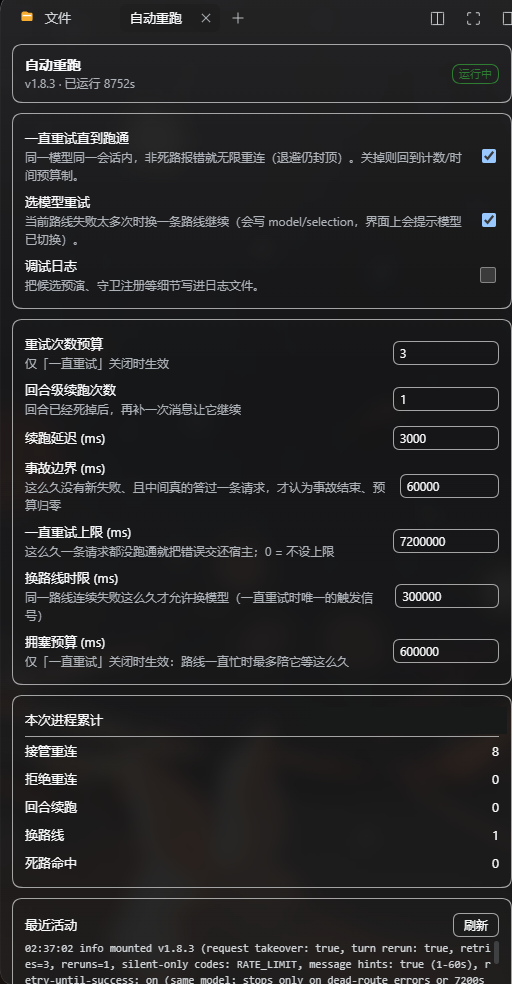

# dsh-auto-rerun — 模型断连自动重跑

DeepSeek Harness 宿主插件。当模型请求因**断连类故障**（网络断开、代理/VPN 重启、
限流、5xx 服务错误、流中断、超时）失败时自动恢复，不让任务死在一条红字上。

## 它做什么

- **同回合自动重试**：失败不抛给你，插件接管重试，任务从断点继续往下跑。
- **限流长退避**：429 / `tpm exhausted` 这类分钟级配额，用 30s→60s→120s→180s 的
  静默长窗口跨过去，而不是撞几次就放弃。
- **听服务端的话**：provider 回 `Retry-After` 或失败文本里的 `retry in ~3s` /
  `retry_after: 5` / `请 3 秒后重试`，就按它给的时刻等，不用自己的窗口。
- **一直试到成功**（`retryUntilSuccess`，默认开）：同一个模型、同一个会话，
  只要不是死路就一直重连，靠退避封顶而不是次数限制防打爆端点；配 2 小时天花板，
  路线彻底坏掉时会把错误如实交还，不会假装还在努力。
- **选模型重试**（`modelFallback`，默认关）：一条路线持续跑不通时，换备选路线
  再试；死路（401/403、订阅过期、key 失效、欠费）立刻换并拉黑 30 分钟。
- **看得见也改得动**：右侧栏面板显示当前路线、重试次数、事故计数，开关和数字
  当场改、立刻生效、重启仍保留（默认仅内存，不写盘）。

**能调的选项**（26 个，完整说明见[配置](#配置cordispatchyml-的-entry-config-或插件行配置)）：
重试次数、初始/最大延迟、退避系数与抖动、限流专用延迟窗口、文本提示上下限、
一直重试的天花板、换路线的触发条件（次数/时长）与次数上限、候选顺序（钉死/
同模型换 provider/自动目录）、死路黑名单时长、事故间隔判定、续跑次数与延迟、
哪些失败码不发可见消息、HTTP 状态集合、语言、调试日志、日志文件、设置文件路径。




---

## 与内置重试的关系（互补，不冲突）

DSH 自带 `@deepseek-ai/dsh-llm-retry`，在每个供应商的 `retryPolicy.normal` 模式
下已经覆盖短窗口抖动（默认 5 次、退避 0.5–10s、jitter 10%）。本插件只做它不想
做的事：

| 层 | 触发 | 行为 | 边界 |
|---|---|---|---|
| **Layer A** 请求级接管 | `agent/request-error` 瀑布下游让出终态（内置重试预算耗尽 / 无 provider policy），且失败属断连类 | 追加自己的长退避重试（默认 3 次、5s→60s 指数退避 + 20% jitter；**限流类单独用 30s→180s 长窗口**；provider 自带的 `Retry-After` 或失败文本里的 `retry in ~3s` 提示优先于类窗口），返回 `{kind:'retry'}` | 默认 `retryUntilSuccess`：**不是死路信号就一直重连**（退避有封顶，不会打爆端点），但最长 `retryUntilSuccessMaxMs`（2 小时）没跑通就把错误交还宿主——否则路线彻底坏掉时会永远静默重试、把错误藏起来；关掉 `retryUntilSuccess` 才回到计数/时间预算制 |
| **Layer B** 回合级续跑 | 请求仍终态失败，`agent/error` 触发，且失败**不属于** `rerunExcludeCodes` | 延迟 3s 后自动 `agent.followup（继续任务）`，让 Agent 新开回合从中断处续跑 | 连续最多 1 次；回合成功 / 用户发新消息 / Agent 销毁即清零 |
| **Layer C** 选模型重试 | **1.6.0 起默认关**（`modelFallback.enabled: false`，需要就打开）。开之后触发条件：① 普通模式下同一条 provider/model 路线把自己那份计数预算用完（且连续失败 ≥ `fallbackAfterFailures`）；② `retryUntilSuccess` 模式下同一条路线连续失败超过 `fallbackAfterMs`（计数预算在该模式下永不耗尽，时间才是唯一信号）；③ 该路线给出**死路信号**（401/403、订阅过期、key 无效、没额度）——死路不等预算，立刻换 | 换一条路线再试，并重置计数预算与新路线自己的时间窗口：优先 `fallbackRoutes` 里钉的，否则从 `ctx.llm` 目录里挑——**优先「同 model id、另一 provider」**（行为不变、配额独立，真能躲限流）；死掉的路线进 30 分钟黑名单，不再当候选 | 单次事故最多换 `fallbackMaxSwitches` 次；每候选都过 `resolveModelInfo` 校验；同一路线只试一次 |

Layer B 会**往会话里发一条消息**（用户可见），所以限流类默认被排除：`RATE_LIMIT`
（含 HTTP 429）只走 Layer A 的静默重试，不打扰用户。限流（如免费线 `tpm exhausted`）
是分钟级配额，短退避必死，Layer A 对它使用 30s→60s→120s 长窗口，足以跨过；
而让它发续跑消息无意义——消息出去也是撞墙，还可能连环触发。

**Layer C 怎么换路线**：优先走宿主的模型选择通道
`ctx.get("sessionController").agents.selectForNextRequest(agent, {provider, model})`
—— 这会落一条 `model/selection` 会话事件，于是会话里出现宿主自己的
`[model changed: …]` 通知、界面上的模型选择器跟着变、重载后仍然生效，**没有任何
偷偷骗人的地方**。拿不到该服务时（非 Web 宿主 / 端口改名）才退化为「只改下一次
请求」：插件在 `agent/request` 瀑布最外层改写 `provider/model`（顺带丢掉从原模型
继承的 `reasoningEffort`，避免新模型不认），并在这条事故结束前持续生效。两种情况
都写一行 `model fallback: a/x → b/y (…)` 日志；用户在界面上自己换过模型时，
尚未落地的临时改写会被丢弃并记日志（不跟用户抢方向盘）。
候选顺序：钉死的 `fallbackRoutes` → **同 model id 的另一 provider** →
**本进程已见过的路线**（宿主自己装配过，在这台机器上确定能跑）→ 目录里其余模型
→ 目录完全拿不到时，只剩「见过的路线」这一级
（同 provider 换个 model 名字通常还在同一个限流桶里，换 provider 才换桶）。

死路信号（`Provider 402/401/403`、`subscription … expired`、`invalid api key`、
`no credits`、余额/额度不足/订阅过期）与拥塞信号（429、`tpm exhausted`、
`retry in ~3s`）严格区分：前者重试无意义、立刻换路线；后者只是等一会儿，
绝不能被当成死路把会话拖走。

永不重试的失败：认证（401/403）、无效请求（400）、上下文超长、协议/代码错误
——这些重试无用，插件会把它们如实交还宿主。只有打开 Layer C
（`modelFallback: { enabled: true }`）时，「认证/订阅过期/额度耗尽」才会先尝试
**换一条路线**，换不了才把错误交还。默认（1.6.0）不换路线：这类"一定的报错"
直接停，别的断连类一直重试。

## 断连类判定

同时支持三种输入（任一命中即算断连类）：

1. **loop 失败码**（默认）：`EMPTY_RESPONSE` `RATE_LIMIT` `SERVER` `TIMEOUT` `TRANSPORT`
2. **POSIX errno**：`ECONNRESET` `ECONNREFUSED` `ETIMEDOUT` `EPIPE` `EHOSTUNREACH`
   `ENETUNREACH` `EAI_AGAIN` 等
3. **HTTP 状态**：408 / 425 / 429 / 500 / 502 / 503 / 504；以及消息文本正则
   （socket hang up、fetch failed、network、disconnected、timed out、
   rate limit、overloaded、service unavailable、bad gateway、gateway timeout 等）

## 安装

```powershell
# 推荐：从 GitHub 发布包安装（任意 DSH 会话里）：
plugin_manager install_bundle "https://github.com/good-saltfish/dsh-auto-rerun/releases/download/v1.8.4/dsh-auto-rerun-1.8.4.tgz"
```

```powershell
# 或本地目录（开发调试用）：
plugin_manager install_bundle "<你本机的仓库路径>"
```

或 Plugin Manager 页面手动安装本地目录。安装后新会话即生效；
正在运行的会话建议重启 DSH 让宿主插件重新挂载。

## 配置（`cordis.patch.yml` 的 entry config 或插件行配置）

| 键 | 默认 | 说明 |
|---|---|---|
| `enabled` | `true` | 总开关 |
| `request.enabled` | `true` | Layer A 开关 |
| `rerun.enabled` | `true` | Layer B 开关 |
| `retries` | `3` | Layer A 每次事故最大接管重试次数 |
| `initialDelayMs` / `maxDelayMs` / `backoffFactor` / `jitterRatio` | `5000` / `60000` / `2` / `0.2` | 普通断连退避参数 |
| `rateLimitInitialDelayMs` / `rateLimitMaxDelayMs` | `30000` / `180000` | **限流类（429/RATE_LIMIT）单独用的静默长退避**；provider 给了 `Retry-After` 就照它等 |
| `honorMessageRetryHint` | `true` | 读**失败文本里**的退避指令（`retry in ~3s` / `try again in 2.5s` / `retry_after: 5` / `请 3 秒后重试`）并按它等，优先于上面的类窗口 |
| `messageHintMinMs` / `messageHintMaxMs` | `1000` / `60000` | 文本提示的取用窗口：太短的值会被抬到下限，过长的会被截断 |
| `busyRouteBudgetMs` | `600000` | **仅 `retryUntilSuccess: false` 时生效**：拥塞类失败在计数预算之外按"静默时长"给时间预算——只要每隔不超过这么久就还能发出一次重连，就一直连；路线真正连续 10 分钟毫无响应才收工 |
| `retryUntilSuccess` | `true` | **核心场景（免费模型容易堵）**：同一个模型、同一个会话内，只要失败不是"一定的报错"（死路：401/403、订阅过期、key 失效、永久没额度），就一直重连直到跑通，计数预算和时间预算都不拦（退避仍封顶：限流最长 180s、文本提示最长 60s 一次，不会打爆端点）。日志里预算栏显示 `until-success #N`。设 `false` 回到 1.5.x 的预算制 |
| `retryUntilSuccessMaxMs` | `7200000` | **「一直重试」的天花板**：连续这么久都没跑通过任何一条请求，就把失败交还宿主（日志写 `until-success window spent (…s >= …s)`）。没有它，路线彻底坏掉时会永远静默重连、把错误藏起来，用户只觉得卡住。`0` = 不设上限 |
| `modelFallback.enabled` | `false` | **选模型重试**开关（1.6.0 起默认关：老大的要求是「就守着一个模型重试」）。开 = true 时，同一条路线连续失败后可换 provider/model 再试 |
| `fallbackRoutes` | `[]` | 钉死的候选路线，按优先级写 `"provider/model"`（如 `["other-provider/model-id"]`）。留空则从 `ctx.llm` 目录自动挑，优先「同 model id 的另一 provider」 |
| `fallbackAfterFailures` | `2` | 换路线的下限：该路线连续失败至少这么多次，且满足下面的触发条件，才换 |
| `fallbackAfterMs` | `300000` | **`retryUntilSuccess` 模式下的换路线触发条件**：在同一路线上连续失败超过这么久才换。该模式下计数预算永不耗尽，只有时间是"真的跑不通"的信号——没有它，面板上的选模型重试开关会静默失效 |
| `fallbackMaxSwitches` | `2` | 单次事故最多换几次路线（每次换完重置计数预算与新路线自己的时间窗口） |
| `fallbackAnyModel` | `true` | `true` = 允许换到**另一个模型**（回合不中断，但答复质量会变，切换在会话与选择器里都可见）；`false` = 只换「同 model id 的另一 provider」，答复质量绝不悄悄变化（代价是可能无候选可用） |
| `incidentGapMs` | `60000` | 两次失败间隔超过这么久**并且**这条路线在中间真的答过一条请求（有 `assistant/message` 持久证据），才算**新事故**，计数/空闲预算全部重新开始。没有它，长回合里 20 分钟前的一次限流会让之后一次偶发抖动被旧预算直接拒掉；只按时间算又会把插件自己的长退避（限流退避 180s > 60s）误当成恢复 |
| `reruns` | `1` | Layer B 连续自动续跑上限 |
| `rerunDelayMs` | `3000` | 终态后到追问的延迟 |
| `rerunExcludeCodes` | `["RATE_LIMIT"]` | **不发可见续跑消息**的失败码（仍走 Layer A 静默重试）；设为 `[]` 可让限流也发消息 |
| `codes` | 内置 5 码 | 自定义断连类失败码列表（整体替换） |
| `extraCodes` | `[]` | 追加的断连类失败码 |
| `statusSet` | `[408,425,429,500,502,503,504]` | 判定为断连的 HTTP 状态 |
| `messagePattern` | 内置正则 | 自定义断连消息正则（字符串） |
| `lang` | `"zh"` | 续跑追问语言 `"zh"` / `"en"` |
| `debug` | `false` | 打印事件 payload 结构日志（排查判定用） |
| `logFile` | 未设 | 可选：把每次决策逐行追加到该文件（**手动测试专用**）。默认关闭，插件保持纯内存；也可用环境变量 `DSH_AUTO_RERUN_LOG` 临时打开而不改配置 |
| `settingsFile` | `${DSH_HOME:-~/.dsh}/auto-rerun-settings.json` | 可选：右侧栏面板改的开关存到哪个文件。留空时若设了 `logFile` 就用它同目录的 `auto-rerun-settings.json`，否则用宿主数据目录；写 `""` 表示开关只活在内存里 |

## 操作面板（右侧栏）

插件带一个浏览器半边（`client.js`），通过 `dsh-better-sidebar` 的服务在**右侧栏**注册
一个「自动重跑」标签页。它只做两件事：把插件**正在做什么**显示出来，让你**当场改开关**。

- **状态区**：版本、已运行时长、是否挂载、当前路线、本次进程累计的
  接管重连 / 拒绝重连 / 回合续跑 / 换路线 / 死路命中 计数，以及最近 60 条活动。
- **开关区**：`retryUntilSuccess`（一直试到成功）、`modelFallback`（选模型重试）、
  `debug`（调试日志）。
- **数字区**：`retries`、`reruns`、`rerunDelayMs`、`incidentGapMs`、`retryUntilSuccessMaxMs`、
  `fallbackAfterMs`、`busyRouteBudgetMs`（失焦或回车才提交）。前四个是预算，后三个是
  **保险丝**：一直重试的尽头、换路线的时限、拥塞陪等的上限——它们就是「无限重试不会
  把会话卡死」的依据，所以跟开关放在一起，而不是只留在 yml 里。
- 面板读写的都是**运行中那份 cfg**，不是另一份副本：改完立刻对下一次失败生效，
  并写进 `settingsFile`（有的话），重启后仍在。

实现上是两条宿主路由，走 `ctx.connection.requestRejection` 的信任围栏
（非本机 GUI 的请求直接 401/403）：

| 路由 | 方法 | 作用 |
|---|---|---|
| `/auto-rerun/api/status` | GET | 返回版本、配置快照、计数、当前路线、最近活动 |
| `/auto-rerun/api/config` | POST | 收 `{ "patch": { ... } }`，只接受白名单键（其余返回 400 `unknown setting`） |

面板依赖 `dsh-better-sidebar`。没装它时浏览器半边只打一条警告，宿主半边照常重试——
**面板是可选的眼睛，不是插件工作的前提**。

## 容错设计

- **不双跑**：Layer A 每次先 `next()`，内置重试接住就绝不插手；下游已给出
  `retry` 决策时直接透传。
- **不越权**：用户点停止 / 会话归档 / 插件卸载时，所有等待与定时器经
  `AbortController` + `ctx.effect` 统一清理。
- **防死循环**：默认一直重连，但拦圈的是**性质**而不是次数——只认断连类失败（认证
  失败、400、上下文超长这类根本不进接管）；死路信号（订阅过期 / key 无效 / 没额度）
  立刻停手并把错误交还宿主；每轮退避都有封顶（限流 180s、普通断连 60s），所以
  「无限重试」是礼貌的节奏，不是打爆端点。关掉 `retryUntilSuccess` 才退回
  计数 / 时间预算制；换路线另有 per-agent 次数预算。User 一旦自己说话立即清零事故态；
  `always` 模式会话完全不管。
- **无侵入**：不 append 与「消息」无关的自定义会话事件（Layer C 只在换路线时按宿主自己的
  `model/selection` 协议写，界面/重载都认它），默认不写磁盘
  （`logFile` 是唯一可选落盘项），崩溃即恢复为原生行为。
- **可降级**：所有 payload 字段读取都是防御式可选链；判定不到的失败一律
  按「非断连」处理，宁可不重跑也不乱重跑。
- **注入消息必须带身份（硬不变量）**：所有写进会话的消息只经唯一注入口
  `admitFollowup()`——构造完整 `UserMessage` → 断言 `id`/`role`/`content`/`source.kind`
  → 才 `followup()`。宿主写入时不校验、冷启动重放才校验，一条缺 id 的 `user/message`
  会让**整份会话加载不出来**；断言不过就抛错（宁可这次续跑失败，绝不写坏会话）。
  回归测试见 `test/inject-shape.test.mjs`（复刻宿主校验规则）。

## 手动测试（三步）

`ctx.logger` 的输出不进任何文件（DSH 不落盘），所以静默的 Layer A 在界面里看不见。
要亲眼验证，先把 `cordis.patch.yml` 里被注释掉的 `logFile` 打开（或设环境变量
`DSH_AUTO_RERUN_LOG`，两者都不用改文件），然后另开一个终端跟着看：

```powershell
# 终端 1：实时看插件决策（路径换成你自己的 logFile）
Get-Content "C:\path\to\auto-rerun.log" -Wait -Tail 20
```

右侧栏面板也是同样用途：它把最近 60 条活动直接显示出来，不写盘也能看。

**测 Layer B（可见续跑，最省事）**：临时把 `rerunExcludeCodes` 改成 `[]`，用它跑
一个长任务直到撞限流 → 会话里应出现一条 `[auto-rerun 1] 刚才与模型的连接中断…`，
并自动接着干。测完改回 `[RATE_LIMIT]`。

**测 Layer A（静默接管，最真实）**：起一个长任务，中途**关掉代理/VPN 或拔网线
60–90 秒**再恢复。预期：不报错、回合自己扛过去；日志里出现
`taking over a disconnect-class failure ... retry 1/3 in 5s` 之类的行。

**测长限流窗口**：撞上限流后日志应出现 `retry 1/3 in 30s`（而不是 5s），说明
限流走的是 30s/60s/120s 长窗口。

改完 `cordis.patch.yml` 需要在插件页把 `auto-rerun` **关一次再开**，新配置才生效。

## 验证方式

1. 安装后让它处理一个长任务；途中断开代理/VPN 几十秒再恢复：应看到
   `auto-rerun: taking over a disconnect-class failure ...` 日志并在恢复后自动继续。
2. 设 `debug: true` 可观察每个事件的判定路径。
3. **验证 Layer C**：先看第一次请求后那行
   `model fallback preview for a/x: would switch to b/y (catalog), llm catalog: readable`
   —— 这是**不发请求、零副作用**的预演，直接告诉你真出事时会换到哪条路线。若写成
   `no candidate available …`，说明这台宿主上找不到候选，请在 `fallbackRoutes` 里钉
   1–2 条可用路线。再看第一次接管时的
   `model fallback wiring: llm catalog reachable|missing, session selection reachable|missing, pinned routes: N`。
   然后让一条路线持续失败（或直接把 `fallbackRoutes` 钉成另一条可用路线）。日志应出现
   `model fallback: a/x → b/y (…)`，界面模型选择器跟着变；走宿主 controller 时还会在
   会话里看到宿主的 `[model changed: …]` 通知。若最终换不了，会看到
   `no fallback route available for … (pinned: 0, llm catalog: missing); staying on this route`。
4. 单元层面：在插件目录跑 `node --test`（即 `npm test`，7 条注入不变量用例）与
   `node --check index.js` 语法自检；行为级冒烟套件共 201 条断言，覆盖 Layer A/B/C、
   面板路由、白名单与路径可移植性。

## 回归测试（改代码前后都请跑）

仓库带 7 条注入不变量单测，外加一套行为级冒烟套件：它用一个假 `ctx` 把三层决策全部
跑一遍，不连网、不发真请求、秒级结束。

```powershell
cd <插件目录>
node --check index.js
node --check client.js
node --test                                              # 7 passed / 0 failed
node dev\smoke.mjs "<插件目录>\index.js"                  # 201 passed / 0 failed
```

`dev/` 不随 npm 包发布（`files` 里没有它），只给改代码的人用。套件覆盖的关键不变量：

- 非断连类失败（400、上下文超长、协议错误）绝不接管；
- 死路信号（401/403、订阅过期、key 失效、永久没额度）**即便开着无限重试也立刻停手**；
- 拥塞类（429、文本自带退避提示）走时间预算一直重连，不再 `close the turn`；
- `retryUntilSuccess` 开/关两套语义都成立，换路线不越过死路判定；
- 换路线的三级降级（宿主 controller → 会话事件 → 下一次请求）、候选顺序与归属；
- 面板白名单拒绝 `constructor`/`__proto__`/`toString` 这类原型键，超大 body 与
  已断开的 socket 都不抛异常；
- `settingsFile` / `logFile` 的默认值不带作者机器路径（发布后的可移植性回归）。

## 已知边界

- Layer A 等待期间若整个宿主进程被杀（崩溃/强退），本次等待丢失；会话恢复后
  该回合停留在失败状态，需要手动继续一句话（内置重试同样受此约束，它的
  持久化只服务自身预算记账）。
- 回合级续跑会把「继续任务」的提示送进模型历史（一条 user-role 消息），断连
  恢复后这是语义正确的上下文，但会占用少量 token。
- Layer C 的持久切换优先走 Web 宿主的 `sessionController`；拿不到时退到自行 append
  `model/selection` 会话事件（界面选择器读它，重载后仍在），再拿不到才是「只对下一次
  请求生效」。三级都会在日志里写明。
- 若宿主既没暴露 `llm` 目录也没暴露 `sessionController`，Layer C 仍能工作：候选退到
  「本进程见过的路线」（至少要有一个别的路线在这台机器上跑过），持久化退到自行
  append `model/selection` 或下一次请求的强制改写；两者都没有时只剩这一行
  `no fallback route available …`，此时请在 `fallbackRoutes` 里显式钉 1–2 条。
- 宿主在创建 agent 时才装自己的 `agent/request` 监听，而 cordis 的 prepend 监听是
  「后注册者最外层」。因此换路线用的守卫**不能在 mount 时注册**（那会被宿主的监听
  套回去），必须在真正换路线的那一刻注册到该 agent 自己的 ctx 上——这是 1.4.1 修的
  关键点。
- 换路线后会话里会出现宿主自己的 `[model changed: …]` 通知（一条 user-role 消息，
  这是宿主对「路由变了」的如实记录），token 开销与上面同类。
- 换过去之后**这条会话就留在新路线上**（和你在界面里手选模型同一个语义），不会因为
  原路线的限流恢复而自动切回。想回去就在界面里把模型选回原路线——插件会立刻让路
  （守卫检测到别处改了路线就丢弃 override，不跟你抢）。

## 变更记录

### 1.8.4 — 截图进仓库与插件市场（纯文档/元数据，无行为改动）

- 新增 `docs/screenshots/panel.png`（右侧栏面板）与 `docs/screenshots/retry-inline.png`
  （会话时间线里的连续重试记录），README 顶部一并引用。
- 新增 `screenshots.json`：声明这两张图为插件市场条目截图（市场的抓取脚本只读插件仓库
  根目录的这个文件，不需要改目录仓库，也不需要 PR；下一夜构建生效）。
- `package.json` 的 `files` 白名单补上截图与 `screenshots.json`，否则 npm 包缺图、
  npm 页 README 会显示裂图。
- 截图做了隐私清洗：裁掉宿主侧栏与壁纸、抹掉面板上的具体模型路线名、切掉会话里与插件
  无关的私密对白与自定义头像，只保留插件自身的功能画面。

### 1.8.3 — 发布前代码审计：换路线指令真的会生效（阻塞级）+ 三处记账修复

按「无 bug、无风险、有容错」的发布门槛做了一轮只读代码审计（index.js / client.js 全量
核对 25 项），四个真实缺陷全部修复：

- **【阻塞级】`selectForNextRequest` 接管切换后，重试请求仍会被宿主用**旧的装配路线**
  盖回去**。宿主的 `selection.assembled` 只在每次 step 开头的 `system-prompt/assemble`
  里刷新，而重试循环内只调 `refreshContext`（其 waterfall 明确「不重跑」）——插件原来在
  宿主接管切换（`hostOwned`）时把自己的 `agent/request` override 清掉，于是
  `agent/request` 监听器把**过期的 assembled 路线**重新套上每一次重试：换路线动作被静默
  撤销，`fallbackMaxSwitches` 次机会全部烧在刚离开的路线上。现在 override 在两种切换
  （宿主接管 / 自建事件）下都保持武装，直到外发请求真的带上目标路线（宿主追上了）才自清，
  或路线被别人移动（用户手动改回）时立刻让路——与「不跟用户抢路线」的既有语义一致。
  新增 case 49 回归（装配过期时仍强制新路线；目标路线到达时守卫自退役；他人移动路线被尊重）。
- **死路切换的立即重试原来完全不记账**：不推进 `retries`、不记 `lastFailAt`、不进
  `stats.takeovers`，面板与日志都看不见这次接管。现在补齐三处记账，并加一拍首步退避
  （`localDelay(cfg, 1)`）：换到的新路线没有失败记录，长退避只会拖延恢复，但全死目录下
  一拍退避能避免请求循环空转打热；总次数仍由 `fallbackMaxSwitches` 封顶。等待可被
  abort（agent 关闭 / 插件卸载），中断时把决定权交还宿主。
- **一条成功答复原来只清事故时钟和连败计数，不清 `retries` / `busyLastAt`**：下一次
  事故开局预算就已经被上次事故花掉，第一拍退避也被乘到 4×。现在 `assistant/message`
  到达时把计数预算与拥塞时钟一并清零（case 44 的「从头计预算」断言同时覆盖此路径）。
- **`previewFallbackOnce` 的"只打一次"原来是进程级闭包变量**：一个 agent 打过预览，
  其它 agent 这辈子都不再打印。改为 per-agent（`st.previewLogged`）+ 进程级双保险。
- **顺带**：`fallbackRouteFor` 的 pinned 白名单分支补注释（人工白名单**有意**越过自动
  守卫，与 `allowed()` 的显式信任同级）；冒烟 case 11 补 `settingsFile: ""`——原用例会
  读到开发者本机被面板写过的真实设置文件（保存的 `rerunDelayMs` 盖过测试的 10ms），
  属测试隔离缺陷而非插件缺陷，但同样会坑下一个在不同机器上跑测试的人。
- **验证**：`node --check index.js` / `client.js` exit 0；`node --test` 7 passed / 0 failed；
  行为级冒烟 **205 passed / 0 failed**（201 + case 49 四条断言 + case 11 隔离修复；
  连跑三次结果一致）；case 49 的首条断言在修复前的代码上确认失败（红→绿验证）。

### 1.8.1 — 容错收口：给「一直重试」装上尽头，让选模型重试真的会触发

发布前按「无 bug、无风险、有容错」复查容错路径，发现两个真问题（不是崩溃，是设计缺陷）：

- **`retryUntilSuccess` 没有尽头**。它的卖点就是「一直重试到跑通」，但当一条路线彻底坏掉
  （端点不通、模型下线、provider 侧持续 5xx）时，无限静默重连等于**把错误藏起来**：用户看不到
  任何报错，只看到会话卡着不动，而日志里每 30 秒一行重试。新增 `retryUntilSuccessMaxMs`
  （默认 2 小时）：连续这么久没跑通过一条请求，就把失败交还宿主，日志写
  `until-success window spent (2h >= 2h) with no completed request`。0 = 不设上限。
- **选模型重试在 `retryUntilSuccess` 下静默失效**。旧触发条件是「把这条路线那份 `retries`
  计数预算用完」，可 `retryUntilSuccess: true` 时计数预算**永远不会耗尽** ⇒ 面板上打开开关
  也不会有任何事发生。现在改为双触发：普通模式看计数预算，`retryUntilSuccess` 模式看
  **时间**（`fallbackAfterMs`，默认 5 分钟同路线连续失败）。换完路线重置新路线自己的窗口。
- 新增 `humanMs()`：日志里的时长按量级选单位。`Math.round(40/1000)` 会打成 `0s`，短窗口
  会看成「已经过期」——排查时最容易误判的地方。
- **事故时钟原来会被插件自己的退避清零**（第三个真问题，最隐蔽）。判定「旧事故已结束」
  只看了「两次失败间隔 > `incidentGapMs`」，但插件自己的限流退避默认可以到 180s，
  比 `incidentGapMs`（60s）还长 ⇒ **每一次自己安排的长时间重试都被当成新事故**，
  `incidentStartedAt` 被反复清零，于是上面两个新机制（`retryUntilSuccessMaxMs`、
  `fallbackAfterMs`）在真实场景里永远不会触发。现在复位必须同时满足「间隔够久」
  **和**「这条路线在**这次失败之后**真的答过一条请求」：`servedAt` 由持久事件
  `assistant/message` 打戳，且必须 `servedAt > lastFailAt` —— 失败前的那次成功不算数
  （换路线时也清零，新路线不认旧路线的功劳）。
- **顺手修掉一个从未生效的监听器**：`session/event` 在宿主里是
  `'session/event'(session, event)` **两个位置参数**，插件原来按单个
  `{ session, event }` 包装对象读取 ⇒ 真实宿主上永远匹配不到，「回合完成即重置」这条
  规则一直是死代码。现在按两参形态读取（同时兼容包装形态），并加了
  `agentForSession()` 反向查表（`ctx.agents.list()` 比对 `agent.session.id`）。
- **「这条路线真的答过」只认三种证据，且都按宿主真实类型写**：
  - `assistant/message` 且 `data.interrupted !== true` —— 被取消的流宿主也会追加一条
    `interrupted: true` 的锚点（携带已交付前缀），那不是「答完了」；一次成功的答复还会
    立刻把 `retryUntilSuccessMaxMs` 的时钟和 Layer C 的 `routeFails` 一起清零，否则一条
    明明在回话、只是抖动间隔短于 `incidentGapMs` 的路线会被天花板误判为坏掉。
  - `turn/end` 的 `reason.kind` 认 `completed` **和** `max-tokens`（回复被 token 预算截断，
    不是路线坏了），`error` / `aborted` / `interrupted` / `blocked` 一概不算。
- **面板补上两枚保险丝**：`retryUntilSuccessMaxMs`（一直重试的尽头）与 `fallbackAfterMs`
  （换路线的时限）以前只存在于配置文件和状态快照里，面板上没有输入框——用户能把「一直重试」
  打开，却看不到、也改不了让这件事安全的上限。现在两个都能在右侧栏直接改，顺手把
  `busyRouteBudgetMs` 也画出来；负值夹到 0，非数字保留原值（不会变成 NaN 把整条判定链污染）。
- **两条「只在极端情况才炸」的路径**（都靠读代码找出来的，正常冒烟打不到）：
  - `markDeadRoute()` 原来只有 30 分钟 TTL 清扫，没有硬上限。某个 provider 若对目录里
    每个模型都答「invalid key」，一分钟内就能拉黑几十条**还没到期**的路线，清扫什么都不删，
    Map 随新路线名一直涨。现在多了 `DEAD_ROUTES_MAX = 64`：超了先扫到期条目，还超就按
    插入顺序淘汰最旧的。
  - 调试行 `failure=${JSON.stringify(failure)}` 写在 `agent/request-error` 监听器里、
    **在重试决策之前**。provider 的 failure 对象常带 `cause` 链和 response/socket 引用，
    `JSON.stringify` 会抛 `Converting circular structure to JSON` ⇒ 只要打开 `debug`，
    唯一能救回合的钩子就被自己的日志炸掉了。现在统一走 `safeJson()`（JSON 失败退回
    `String(value)`，再失败给 `"[unprintable]"`），任何输入都不会抛。
- **验证**：`node --check index.js` / `client.js` exit 0；`node --test` 7 passed / 0 failed；
  行为级冒烟 **193 passed / 0 failed**（连跑两次结果一致），新增 case 42（天花板生效、
  0 = never、短窗口不误报 0s）、case 43（relentless 下换路线真的触发 + 等待窗口内不乱换）、
  case 44（`session/event` 必须是两参、`assistant/message` 才能关闭事故、`turn/end`
  的 `completed` / `max-tokens` 都算正常收尾而 `error` 不算、答完一条即刻重置天花板）、
  case 45（**失败之前**的那次成功不算恢复证据；`interrupted: true` 的答复不算已服务）、
  case 46（自引用的 failure 与 `toJSON` 会抛的对象都必须照常重试）；
  case 35 反转成回归测试（**只有**时间间隔、没有已服务证据时预算不得清零）；case 40 补 4 条
  面板断言（两个保险丝能经白名单写入、负值夹到 0、非数字保留原值）。

### 1.8.2 — 真实宿主跑通后修的三个缺陷：切了路线却还报旧模型

1.8.1 的所有结论都来自离线冒烟。为了做到「无 bug、无风险」的验收，另外建了一个临时
profile（`autorerun-verify`）把插件挂进真实 DSH 宿主，用 `--patch` 注入一个指向
`127.0.0.1:9`（关闭端口）的假 provider 构造真实 `ECONNREFUSED`，第一次真的跑通了
Layer A 的接管、`retryUntilSuccessMaxMs` 的收手与 Layer C 的换路线。过程中暴露了三个
**离线永远打不到**的缺陷：

- **切换路线后仍然用旧模型的标签记账**（最严重）。`agent/request` 的 override 生效时
  立刻返回了新 config，但 `st.seenRoute`（下一次失败用来判断「是哪条路线出的事」的快照）
  是在 override **之前**记的 ⇒ 真实日志写成
  `model fallback: deadroute/dead-model → deadroute2/dead-model2` 之后，紧接着的接管行还是
  `provider=deadroute2 model=dead-model`：provider 换了，model 是旧的。后果不只是日志难看：
  下一次失败会把一条**从没被请求过**的路线当成元凶，拉黑它、再「从」它换走。现在先算出
  实际要发的 config，再按它记 `seenRoute` / `rememberRoute` / `previewFallbackOnce`。
- **日志标签把两个来源拼在一起**。接管行原来是 `provider=${payload.provider}
  model=${seenRoute.model}`：provider 来自失败载荷、model 来自路由快照，两者可以属于不同
  路线，于是打出了现实中不存在的 `deadroute2/dead-model`。现在整行统一用 `routeKey(route)`，
  provider 与 model 一定同源。
- **亚秒退避打印成 `in 0s`**。活体日志里 400ms 的退避写成 `in 0s`，读起来像「立刻重试」，
  排查时最容易误判。现在所有时长都走 `humanMs()`。
- **验证**：`node --check index.js` / `client.js` exit 0；`node --test` 7 passed / 0 failed；
  行为级冒烟 **201 passed / 0 failed**，新增 case 47（亚秒时长不得打成 0s，拒绝原因同理）、
  case 48（被强制改写的请求，下一次失败必须记在新路线上，不许甩给刚离开的那条）；case 27
  的断言从 `model=<id>` 改成 `route <provider>/<model>`。
- **活体复跑日志**（改完后）：`retry 1/3 in 172ms` → `retry 2/3 in 400ms` →
  `retry 3/3 in 400ms` → `model fallback: deadroute/dead-model → deadroute2/dead-model2` →
  `route deadroute2/dead-model2` → `until-success window spent (17s >= 4s)` → 宿主把
  `dsh: TRANSPORT: Connection error.` 抛给用户（exit 1）→ `disposed: all listeners and
  timers cleared`。

### 1.8.0 — 可发布版本：换机器也不写错路径 + 审计收尾

- **`settingsFile` 有了可移植默认值**：以前它只能由 `logFile` 推导，而 `logFile` 没设时
  面板开关只活到进程结束。现在缺省落在 `${DSH_HOME:-~/.dsh}/auto-rerun-settings.json`
  （宿主自己的数据目录，和 DSH 解析数据的规则一致），显式写 `settingsFile: ""` 才回到
  纯内存。解析逻辑内联在 `dshHome()` 里，不 import 宿主的 `@deepseek-ai/dsh-home-paths`——
  纯宿主插件不能假定那个包在它的安装目录里解析得到。
- **`logFile` 默认不再写盘**：`cordis.patch.yml` 里原来钉的是作者本机的一个绝对路径，
  别人装会往不存在的目录写。现在这一行被注释掉，
  并新增环境变量 `DSH_AUTO_RERUN_LOG` —— 手动测试时设个路径就能开日志，不用改配置。
- **发布元数据**：`package.json` 补 `repository` / `homepage` / `bugs` / `author`，
  `files` 带上 `LICENSE`；仓库补 `LICENSE`（MIT）与 `.gitignore`（忽略日志、面板状态文件、
  `npm pack` 产物）。
- **挂载行多了 `settingsFile`**，一眼能看出面板开关落在哪。
- **审计结论（承接 m02626 的「有无崩溃、有无 bug」）**：日志里 **0 次崩溃**（无栈、无
  `uncaught`），另修 9 个真实缺陷：面板 `modelFallback` 开关被 400 拒、`constructor` /
  `__proto__` 绕过白名单、重复注册路由的异常逃出 `apply()`、`void handleApi` 的
  unhandled rejection、超限 body 越界缓冲、`pluginVersion()` 每 2s 读盘、跨源 `urlFor`、
  面板渲染崩溃无错误边界、折叠时仍在轮询。
- **验证**：`node --check index.js` exit 0；`node --test` 7 passed / 0 failed；
  行为级冒烟套件 **160 passed / 0 failed**。

### 1.7.0 — 右侧栏操作面板：看得见，也能当场改

- **新增浏览器半边 `client.js`**，通过 `dsh-better-sidebar` 的 `registerTab` 在右侧栏注册
  「自动重跑」标签页（`package.json` 补 `exports["./client"]`、`files`、`dsh.client`）。
  之前插件是「看不见的黑盒」：到底接管没接管、卡在等多久、计数器还剩几次，只能翻日志。
- **新增两条宿主路由** `/auto-rerun/api/status` 与 `/auto-rerun/api/config`，
  走 `ctx.connection.requestRejection` 的信任围栏。面板读的、改的都是运行中那份 `cfg`，
  不存在第二份状态：改完立刻对下一次失败生效。
- **写入走白名单**（`SETTINGS`）：只有开关和几个数字可改，`messagePattern` / `codes` /
  `fallbackRoutes` 这类会改变判定语义的键一律 400 拒绝——面板不能把插件的接线改坏。
- **开关持久化**：改动写进 `settingsFile`（默认 `${DSH_HOME:-~/.dsh}/auto-rerun-settings.json`），
  重载后仍在；写 `settingsFile: ""` 时只活到进程结束，符合「纯内存插件」的默认。
- **新增计数**：接管重连 / 拒绝重连 / 回合续跑 / 换路线 / 死路命中，面板直接显示，
  也是排查「到底有没有在重连」最快的一眼。
- **验证**：smoke 套件 140 passed / 0 failed（新增 18 条面板断言：路由注册、围栏 403、
  状态载荷、开关写入、白名单拒绝、方法/404、计数随真实接管前进、活动流带接管行）；
  `node --test` 7/7；`node --check` 两个半边都 exit 0。

### 1.6.0 — 默认「同一个模型一直试到成功」，换路线改为需要显式打开

- **老大的要求**（原话）：「我只需要针对同一个模型 一个会话内 如果不是一定的报错信息
  就一直重试（场景是使用免费模型 但容易堵塞 让他一直试 直到运行成功这样）」。
  也就是说：1.4/1.5 加的 Layer C（换模型）**不是他要的默认行为** —— 他要的是守着
  这一个免费模型硬扛堵塞，直到跑通。会话里真实出现过两条 `[model changed: …]`
  通知（qoder-cn→qoder、qoder→qoder-cn）就是 Layer C 自己触发的，正是他不想要的。
- **改动一：新增 `retryUntilSuccess`（默认 `true`）**。Layer A 在失败**不属于死路**
  时不再受计数预算（`retries`）与空闲时间预算（`busyRouteBudgetMs`）限制，一直重连
  直到这一轮成功。防打爆端点靠的是**退避封顶**（限流 180s / 文本提示 60s / 普通断连
  60s），不是次数。日志里预算栏变成 `until-success #N (idle Xs)`，一眼看出这是
  「无上限重连」而不是「第 3 次里的那 3 次」。
- **改动二：`modelFallback.enabled` 默认改 `false`**。选模型重试变成**可选功能**，
  想开就在配置里写 `modelFallback: { enabled: true }`（Layer C 的实现、候选顺序、
  三级持久化、死路黑名单全部保留，未删）。
- **保留的刹车**（这是「不是一定的报错就一直重试」里的"一定的报错"）：
  `deadRouteReason()` 命中的失败（401/403、`AUTH`/`SUBSCRIPTION_EXPIRED`/
  `INVALID_API_KEY`/`BILLING`/`INSUFFICIENT_CREDITS`、订阅/套餐过期、余额/额度不足）
  仍然**立刻停手**把错误交还宿主——重试一万次也一样，继续等只是把会话钉死。
  非断连类失败（400、上下文超长、协议/代码错误）也照旧不进接管。
  死路判定在 Layer A 的最前面，所以 `retryUntilSuccess` 关不掉它。
- **回退方式**：`retryUntilSuccess: false` 一行回到 1.5.x 的全部预算行为；
  Layer C 想回来就 `modelFallback: { enabled: true }`。
- **验证**：`node --check index.js` exit 0；冒烟套件新增 case 36–39（默认无限重连
  8 次全放行且日志为 `until-success`、mount 行显示 `retry-until-success: on`、不触发
  换路线；case 37 普通断连同样不封顶；case 38 `retryUntilSuccess: false` 恢复终态并
  回到 `busy-route budget` 措辞；case 39 死路即便开着无限重试也停手、日志点名死路原因）。
  断言旧预算/Layer C 行为的既有用例不改一行：共用 FAST 夹具统一钉上
  `retryUntilSuccess: false, modelFallback: { enabled: true }`（1.5.x 语义）。
  套件现为 **120 passed / 0 failed**；`node --test` 仍 7 passed / 0 failed。

### 1.5.1 — 注入消息的不变量加固（写坏会话的事故不再可能有第二次入口）

- **不变量**：任何写进会话的消息必须是**带身份的完整 `UserMessage`**——
  非空字符串 `id`、`role: "user"`、数组 `content`、`source.kind` 非空。宿主**写入时
  不校验**（`agent.followup()` / `Session.append()` 照单全收），**冷启动重放时才校验**
  （`assertMessageEventShape()`），一条缺 id 的 `user/message` 会让整份会话抛
  `session event at seq N lacks an identified message` 并**一条都加载不出来**。
- **触发场景**：上游断连 → Layer B 注入「继续任务」的续跑消息。1.1.1 及更早正是用裸
  对象 `{ content, source }` 写坏过真实会话（1.1.2 修）。外部复核（另一 AI）确认诊断
  属实；同类缺陷在官方 Discussions 也有报告：**#4819**、**#11216**（同一模式：写不校验、
  读才校验）。
- **本次加固**（不改行为，只堵入口 + 加断言 + 加测试）：
  - 新增唯一注入口 `admitFollowup(agent, { content, source })`：内部构造 → 断言 → 才
    `followup()`；断言不过就 `throw`（宁可这次续跑失败，也不写坏整份会话）。以后新增
    注入点必须走它，不许再直接调 `followup`。
  - `buildUserMessage` 不再「信任」宿主实现：若返回对象缺 `id`/`role`，用
    `randomUUID()` 补齐后再返回；`source` 缺失或不是合法对象时归一成
    `{ kind: "auto-rerun" }`（缺 kind 同样会被校验器整份拒绝）。
  - 注入消息的 `source` 统一为 `{ kind: "auto-rerun", form: "notice", summary: "auto-rerun attempt N" }`。
    `kind` 值未改（日志/测试都引用它）。`form: "notice"` 让界面把它渲染成可折叠的
    通知，一行摘要就是 `summary`，正文是提示词——事后能从会话直接看出是哪一次重跑。
  - `st.reruns = n` 移到注入**之前**：万一注入抛错，重跑上限依然生效，不会变成循环。
  - 新增 `test/inject-shape.test.mjs`（`npm test`，即 `node --test`）：7 条用例，含
    复刻宿主校验规则的 `assertMessageEventShape`，断言裸对象**必须**被判不合格、
    id 是合法 UUID 且两次调用不相同、残缺返回会被补齐、抛错的 `followup` 会如实冒泡。
  - 测试接缝新增 `__admitFollowup`、`__unidentifiedReason`。
- **验证**：`node --check index.js` exit 0；`node --test` **7 passed / 0 failed**；
  既有冒烟套件（现在的 `dev/smoke.mjs`）仍 **104 passed / 0 failed**（其中
  「注入的续跑消息带完整身份」断言由新注入口继续满足）。

### 1.5.0 — 死路路线立刻换，不再干等

- **问题**：认证失败、订阅过期、key 无效、额度耗尽这类失败**重试一万次也一样**，
  插件以前把它们原样交还宿主，回合当场结束。历史会话里就有因为
  `Your subscription has expired` 连续六轮 goal 空转最后死掉的例子。
- **修复**：新增死路判定（HTTP 401/403、`AUTH`/`UNAUTHORIZED`/`FORBIDDEN`/
  `SUBSCRIPTION*`/`INVALID_API_KEY`/`BILLING` 等失败码，以及 `subscription …
  expired`、`invalid api key`、`no credits`、余额/额度不足、订阅/套餐过期等文本），
  命中后**不等计数预算**直接换路线（Layer C），换成功就返回 `{kind:'retry'}`
  让下一次请求走新路线；换不了才把失败交还宿主，并只警告一次。
- **死路黑名单**：被判死的路线进 30 分钟黑名单（进程内、按 `provider/model`），
  期间不再作为换路线候选——否则会换到一个同样过期的地方白烧一次配额。
- **严格区分拥塞**：429 / `tpm exhausted` / `retry in ~3s` 不是死路，仍按 Layer A
  的长退避等待，绝不因为「看起来像限流错误码」就把用户的会话拖到别的模型上。
- **附带修正**：换路线后立即把 `seenRoute` 记成新路线，这样紧接着的失败日志与
  死路记账不会还挂在刚离开的那条路线上（否则会出现「明明是 beta 挂了，日志写的
  是 alpha」以及黑名单记错对象）。
- **可预演的候选**：第一次请求后会打印一行
  `model fallback preview for a/x: would switch to b/y (catalog)` —— 真正的候选搜索，
  但不切换任何东西。换路线这一层从此**在出事之前就能验证**，不用等死一次回合。
- **修掉一个同类隐患（事故边界）**：计数/空闲预算原来只在「回合结束 / 用户发消息」时清零。
  长回合里 20 分钟前碰过一次限流，之后一次几秒的偶发抖动会被旧预算判成「预算已用完」
  直接放行给宿主 → 回合又死。现在两次失败间隔超过 `incidentGapMs`（默认 60s）就当作
  新事故，预算重新开始。（1.8.1 补上了这条规则缺的另一半：间隔之外还必须**有已服务的
  证据**，否则插件自己的长退避会被误判成恢复——见上面 1.8.1 的第三条。）
- **`fallbackAnyModel`**：默认 `true`（回合活命优先，切换在会话/选择器里可见）；
  设 `false` 则只换「同 model id 的另一 provider」，答复质量绝不悄悄变化。
- **测试**：新增「订阅过期立刻换路线」「所有路线都死了就停手并只警告一次」
  「429 不被判死」「预演只打一行且指向真实候选」「只换同 model 时不换模型」
  「长间隔算新事故、预算重新开始」六组用例；套件 **104 passed / 0 failed**。

### 1.4.2 — 候选顺序更靠谱 + 日志不刷屏

- **候选顺序**：钉死的 `fallbackRoutes` → 同 model id 的另一 provider → **本进程已经
  见过的路线** → 目录里其余模型。第三级排到目录前面，是因为「宿主刚在这台机器上用它
  跑通过」比「目录里写着有、但订阅可能早过期」更能保证换过去不会立刻再挂。
- **已经交给宿主就不叠加 override**：`selectForNextRequest` 成功时不再同时留着
  强制改写，避免和用户的模型选择器抢路线（抢的结果是日志说换了、实际还在原路线上）。
- **`no fallback route available …` 每个事故只警告一次**（之前是每次失败都刷一行），
  其余信息留在 `debug: true` 的 dbg 行。
- **测试**：新增「同 model id 另一 provider 优先于见过的其它模型」用例；套件
  **88 passed / 0 failed**。

### 1.4.1 — 换路线真的生效（监听顺序）+ 服务探测

- **问题（1.4.0 已挂载后暴露）**：日志里连一 `model fallback:` 都没有。两处原因叠加：
  ① 这个宿主里 `ctx.get("llm")` / `ctx.get("sessionController")` 未必可达，目录为空
  ⇒ 没有任何候选；② 即使钉了候选也可能白换——宿主是在**创建 agent 时**才安装自己的
  `agent/request` 监听，而 cordis 对 prepend 监听是「后注册的在最外层」，插件 mount 时
  注册的那个反而在**里层**，它设好的路线会被宿主在外层原样套回自己的 route。换路线
  的效果就这样被静默吃掉。
- **修复**：
  - 换路线的那一刻注册 `agent/request` 守卫（`{ prepend: true }`），且**同时注册在
    agent 的 scoped ctx 和插件自己的 ctx** 上——宿主自己的模型选择监听就是装在前者
    里的，而 cordis 对 prepend 监听是「后注册的在最外层」（已在 app.asar 里核实：
    `register(){ hooks[prepend?'unshift':'push'](...) }`），所以只有后注册才盖得住；
    两处都注册就不必猜哪个被采纳。用户/宿主自己动路线时守卫立刻让路
    （`fallback override dropped …`）。
  - 持久化改成三级降级：`sessionController.agents.selectForNextRequest`（宿主通知 +
    界面选择器同步，**这一级成功就不再叠加 override**，免得跟用户抢路线）→ 自行
    append `model/selection` 会话事件（界面同样读它，重载后仍生效）→ 仅本插件强制改写
    （整个事故期间有效，用户显式换路线即让路）。日志会写明这次实际走了哪一级。
  - 候选来源同样不再只靠目录：目录拿不到时退到**本进程已经见过的路线**（宿主自己
    装配过的 `provider/model`），所以哪怕这个宿主不给插件目录，只要这台机器上别的
    会话跑过第二条路线，就能自动换过去；钉死的 `fallbackRoutes` 依旧优先。
  - 一次性接线探测：第一次真正接管时打印
    `model fallback wiring: llm catalog reachable|missing, session selection reachable|missing, pinned routes: N`
    ——换路线没反应时先看这一行，别再猜。
  - `routeGuard` 随 agent 一起销毁（`agent/disposed` → `dropAgent`），不随事故清零而丢。
- **测试**：新增「宿主后注册的监听不能吃掉换路线」「无目录无钉死时用本进程见过的路线」
  两组用例；套件 **87 passed / 0 failed**。

### 1.4.0 — 路线忙不再断线（时间预算）+ 选模型重试

- **问题一（逻辑错误，不是 bug）**：1.3.0 给「拥塞类」加的是**事故时长**预算
  （事故开始后 600s 就收工）。真实日志证明这个口径是错的：qoder-cn 的队列忙持续
  45 分钟以上，期间上游一直在正常回答 `retry in ~2s`，而插件在
  `busy for 658s > 600s` 之后就**永久**拒绝该 agent 的每一次重连
  （`busy for 4170s/4326s/4748s/5114s/5314s/5565s > 600s; letting the failure
  close the turn`，同一 `session-cbbad5a7` 连续 6 次）——上游已经恢复，插件却因为
  「事故太老」再也不救。这就是老大说的「路线太忙就直接断了而不是重连」。
- **修复一**：改成**空闲**时间预算（`busyRouteBudgetMs`）——只要还在持续发出重连
  尝试就一直连下去；只有连续这么久都没发出一次尝试才放弃。持续拥塞⇒无限重连；
  偶发抖动⇒照旧受 `retries` 计数约束；用户说话/回合成功⇒清零重来。
- **问题二（新需求）**：一条路线彻底不可用（配额、封禁、供应商侧故障）时，等多久
  都没用，需要**换模型重试**。
- **修复二（Layer C）**：一条路线把自己那份计数预算用完（且连续失败 ≥
  `fallbackAfterFailures`）就换路线，走宿主 `model/selection` 通道（见上文
  「Layer C 怎么换路线」），换完重置计数预算，单次事故最多换 `fallbackMaxSwitches`
  次。默认从 `ctx.llm` 目录挑，**优先换 provider**——配额是 per-provider 的，
  同 provider 换个 model 名字通常还在同一个限流桶里；同 model id 的另一 provider
  排最前，行为不变、配额独立。
- **诊断改进**：处置日志的 `model=` 改取「宿主这次真正装配的路线」（`agent/request`
  瀑布读到的配置，取不到就退到会话的 `requestHeader().config`），不再恒为
  `unknown`；mount 行新增
  `model fallback: after 2 failures, max 2 switch(es), pinned: …` 与
  `busy-route budget: 600s`，重载后一眼能看出跑的是哪一版。

### 1.3.0 — 尊重 provider 在失败文本里给的退避指令

- **问题（真实日志证据）**：Qoder 用队列忙信号回答请求——
  `Qoder is busy — the request was queued (retry in ~3s)`，`type: "rate_limit"`、
  status 503，**退避指令写在文本里而不是 `Retry-After` 头**。插件只认结构化
  `providerRetryAfterMs`，于是把它当成分钟级配额限流，套用 30s→60s→120s 长窗口：
  实测日志 `retry 1/3 in 35s` / `retry 2/3 in 66s` / `retry 3/3 in 132s`
  —— 上游 3 秒就恢复的队列忙，插件硬等 3 分半，还把 3 次重试预算全烧在
  冷窗口上，最后 `layer A budget exhausted` 让回合死掉。**慢不等于稳，而是把
  预算浪费在已经不忙的上游上。**
- **修复**：Layer A 退避优先级变为
  ① provider 结构化 `Retry-After`（`providerRetryAfterMs`）
  → ② **失败文本里的提示**（`retry in ~3s`、`try again in 2.5s`、`retry_after: 5`、
  `请 3 秒后重试`、`稍等 2 分钟后再试`；`ms`/`s`/`m`/`秒`/`分钟` 都认）
  → ③ 类窗口（限流长窗 / 网络短窗）。
  提示经 `messageHintMinMs`（默认 1s，挡住 "retry in ~0s" 之类的忙轮询）与
  `messageHintMaxMs`（默认 60s）夹紧后再抖动；`honorMessageRetryHint: false`
  可整体关掉。日志行会标出取值来源：`in 3s via=message-hint`。
- **不影响的面**：没有文本提示的失败（`tpm exhausted`、`rate limit reached for RPM`）
  照旧走长窗口；配额类语义没变，变的是「上游明确说几秒后回来」时不再硬等。
- **诊断**：mount 行现在带真实版本号（`mounted v1.3.0 …`）并显示
  `message hints: true|false`，用来区分「真的重新加载了」和「模块缓存里的旧副本」；
  处置日志的 `model=` 也从 payload 的多个嵌套位置回退取值，不再恒为 `undefined`。

### 1.2.0 — 限流静默长窗口

- 限流类（`RATE_LIMIT` / HTTP 429）不再和网络抖动共用 5s→60s 短窗口：tpm/RPM
  配额要几十秒到一分钟才清零，短窗口硬撞必死。新增
  `rateLimitInitialDelayMs`（30s）/ `rateLimitMaxDelayMs`（180s），并继续尊重
  provider 的 `Retry-After`。
- 新增 `rerunExcludeCodes`（默认 `["RATE_LIMIT"]`）：限流只走 Layer A 的静默重试，
  **不发可见的续跑消息**（消息出去也是撞墙，还可能连环触发）。设 `[]` 可恢复
  让限流也发续跑提示。

### 1.1.2 — 修复会话被写坏（重要）

- **问题**：1.1.1 及更早用裸对象调 `agent.followup({ content, source })`。宿主
  会**原样持久化**传入的对象，于是落盘的 `user/message` 事件缺 `message.id`
  与 `message.role`。冷启动重放时校验器 `assertMessageEventShape()` 抛
  `session event at seq N lacks an identified message`，**整份会话直接判 corrupt、
  一条历史都打不开**（不是丢某条消息，是整本打不开）。
- **触发条件**：只有真的发生过断连自动续跑才会写坏，所以平时不显形，等重启
  DSH 才炸。
- **修复**：注入消息改为完整 `UserMessage` —— 优先用官方
  `createUserMessage({ content, source })`（从 `@deepseek-ai/dsh-llm` 动态导入，
  由宿主模块表解析），解析不到时按同一形状手工兜底
  `{ id: randomUUID(), role: "user", content, source }`。动态导入保证即使该
  specifier 不可用也不会让插件加载失败。
- **同型 bug 参考**：DSH Discussions #4819（`dsh-agent-loop` 的 auto-continue
  通知同样缺 `message.id`）、#11216（会话事件只读时校验、写时不校验）。
- **已坏会话可救**：补 `id`/`role` 后逐帧重压即可恢复（`Session.append` 写时照收，
  冷启动重放时才校验，所以修复脚本必须先备份原文件）。

